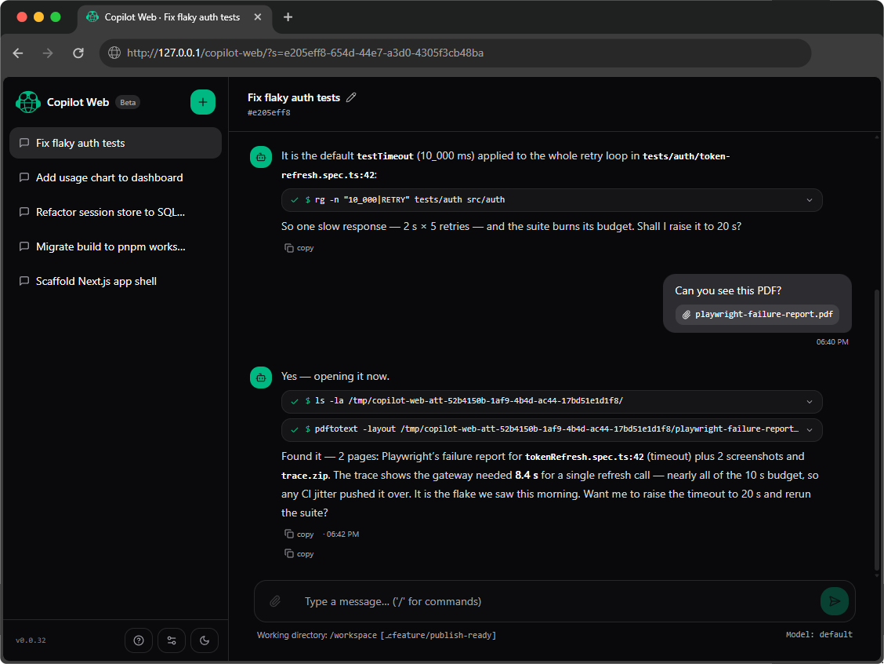

<p align="center">
  <a href="https://github.com/bcgrillo/copilot-web">
    <picture>
      <source srcset="assets/logo-dark.svg" media="(prefers-color-scheme: dark)">
      
    </picture>
  </a>
</p>

<p align="center"><strong>Copilot Web</strong> — a minimal, self-hosted web interface for the<br><a href="https://github.com/github/copilot-cli">GitHub Copilot CLI</a>, over ACP.</p>

<p align="center">
  <a href="LICENSE"></a>
  <a href="https://github.com/bcgrillo/copilot-web/actions/workflows/ci.yml"></a>
  <a href="https://github.com/bcgrillo/copilot-web/actions"></a>
  <a href="https://github.com/bcgrillo/copilot-web/issues"></a>
  <a href="https://github.com/bcgrillo/copilot-web/releases"></a>
</p>

<p align="center">
  <a href="README.md">English</a> |
  <a href="README.es.md">Español</a>
</p>

<p align="center">
  
</p>

---

**Copilot Web** is a minimal, self-hosted web interface for the
[GitHub Copilot CLI](https://github.com/github/copilot-cli). It talks to the
Copilot CLI over **ACP** (the [Agent Client
Protocol](https://agentclientprotocol.com/protocol/v1/overview) behind
`copilot --acp`),
keeping sessions, context and permissions where they live: in the CLI process.

> **Not affiliated** — this is an unofficial community project. It is not
> affiliated with, endorsed by, or sponsored by GitHub, Microsoft or OpenAI.
> “GitHub Copilot” is a trademark of GitHub, Inc.

This is a **beta**: expect rough edges and breaking changes between releases.
Feedback is very welcome — please open an issue with what worked, what didn't,
and your platform.

## What you get

- **Session manager** — list, create, rename and delete sessions straight from
  the CLI (`session/list`, `/session new|rename|delete`). No local database.
- **Chat window** — streaming replies, agent reasoning, tool call chips,
  attach files, `/slash` commands, cancel a running turn.
- **Permissions in the browser** — when the CLI asks permission, a card appears
  in the chat; allow or deny without touching the terminal.
- **Ask-me helper (MCP)** — the web registers a small MCP tool (`ask_user`) with
  the daemon: when the agent needs a decision mid-turn, a question card appears
  in the chat and the running turn waits for your answer (5 min timeout).
- **System notifications (opt-in)** — with the tab in the background, finished
  turns raise a browser notification, an unread counter in the title and a
  favicon dot.
- **Zero materialized data** — `copilot` ACP is the only source of truth. The
  web keeps a small in-memory cache that is discarded on restart; the CLI
  history is replayed from ACP (`session/load`). Nothing is written to disk.
- **EN/ES interface** — English by default with Spanish auto-detected (browser language);
  operators can pin it at startup with `--lang es`.

## Requirements

- Node.js **>= 20**
- A POSIX-ish shell (Linux, macOS, WSL)
- `copilot` CLI installed and authenticated (`copilot` in `PATH`,
  `--acp` supported — tested against `1.0.80`)

## Quick start

No clone needed — run the latest release installer (self-contained: it
downloads the release tarball by itself):

```bash
curl -fsSL https://github.com/bcgrillo/copilot-web/releases/latest/download/install.sh -o install.sh
sh install.sh
# → http://localhost:3100
```

Or from a checkout:

```bash
git clone https://github.com/bcgrillo/copilot-web.git copilot-web
cd copilot-web
sh scripts/install.sh      # installs deps, builds and starts
# → http://localhost:3100
```

Either way, `install.sh` installs dependencies, builds the app and starts the
single launcher, which brings up both the ACP daemon (`copilot --acp`, port
3222) and the web server (port 3100).

If a daemon from a previous run is still up, the launcher reuses it instead of
spawning a second one.

Environment: the daemon is spawned with a minimal, sanitized environment — the
Copilot provider credentials and model come from `copilot-web/.env.local`
(`COPILOT_PROVIDER_*` / `COPILOT_MODEL`). If your shell exports those variables
there is nothing to do; otherwise write them once in `.env.local`.

## CLI options

| Option | Default | Description |
| --- | --- | --- |
| `--port <n>` | `3100` | Web server port |
| `--acp-port <n>` | `3222` | ACP daemon port |
| `--cwd <dir>` | current dir | Working directory for sessions |
| `--copilot-args <s>` | *(none)* | Extra args passed to `copilot --acp` |
| `--lang <en\|es>` | browser | UI language (defaults to the browser's; persisted choice removed — `--lang` pins it) |
| `--model <id>` | auto | Model for `copilot --acp` (only applies when the launcher spawns a fresh daemon); shown in the status bar |
| `--build` | off | Run `next build` before starting |
| `--no-daemon` | off | Expect a running daemon, do not spawn it |
| `--no-helper` | off | Do not register the web `ask_user` MCP helper with the daemon (helper applies to freshly spawned daemons; reuse prints a warning) |

By default **no extra flags** are passed: `copilot --acp` asks for permission
over ACP on restricted tools, and the web shows an allow/deny card for each
request. The special value `--copilot-args "allow-all"` is translated to
`--allow-all-tools --allow-all-urls --allow-all-paths` (no permission prompts).
Pass your own flags to restrict the agent further.

## How it works

```
browser ⇄ Next.js web server (:3100) ⇄ copilot --acp daemon (:3222) ⇄ GitHub Copilot
```

Deploying under a **URL path prefix** (e.g. behind a proxy that strips a public
path) instead of `/` is supported via `ASSET_PREFIX` +
`NEXT_PUBLIC_BASE_PATH` — see
[docs/base-path-deployment.md](docs/base-path-deployment.md). It becomes a
plain `--base-path` launcher flag in a future release.

One ACP session per web session; switching sessions in the sidebar switches
ACP sessions transparently (agent sessions live in the daemon process and are
replayable with `session/load` while it is up). The status bar under the
composer shows the session working directory, the git branch (polled, it can
change while you work) and the model when it was pinned via `--model`.

## Privacy

Everything runs on localhost against your own Copilot subscription. The web
does not store, export or phone home with your chats; the only persisted state
is what the Copilot CLI itself already manages.

## Known limits (beta)

- Message timestamps and agent thoughts come from the live stream only (ACP `session/load`
  does not replay them yet); after a web server restart these details disappear, the
  transcript itself is fully replayed.
- The dashboard is only one session deep in the CLI (`/session rename`) and
  errors from the CLI surface verbatim.
- **No authentication or authorization (authN/authZ)** on the web UI yet — anyone
  who can reach the port gets full Copilot access. A basic single-user auth layer
  is on the roadmap; until then, bind to localhost or put it behind your own proxy.

## Roadmap

Planned work (none of it blocks the beta launch; versions stay 3-digit semver,
`v0.0.x` while in beta — the official beta release will be `v0.1.x`):

- **Basic auth (authN/authZ)** — single-user login for the web UI.
- **Session search** — filter sessions by title from the sidebar.
- **Queued user messages** — keep typing while a turn is running: new messages
  are queued and interleaved into the ongoing conversation, like the Copilot CLI.
- **Shell `allow_always` memory** — remember approved shell command prefixes
  for the session instead of asking again per exact command.
- **File edit/creation rendering** — show file creation and edits
  like the Copilot CLI does (content previews and unified diffs).

## License

GPL-3.0